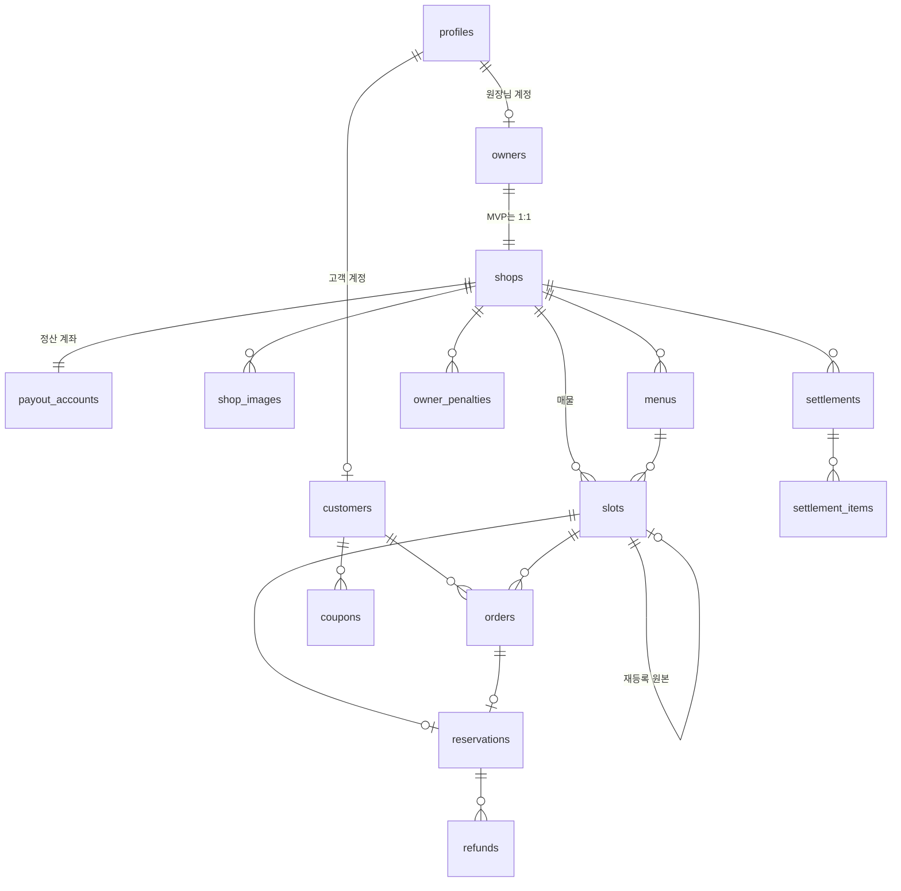

# 스키마 v1 설계

DB 구조 설계안이다. 설계와 변경 승인은 현동훈, 구현(Drizzle 스키마·마이그레이션, `src/db/`)은 강규민이 한다(로드맵 W1).

- 근거: CLAUDE.md "핵심 비즈니스 규칙", [feature-spec.md](feature-spec.md), [tech-guide.md](tech-guide.md) 7, 팀원 요청 #14(강규민)·#18(정찬형)·#22(정민석)
- 이 문서를 바꾸려면 `schema` 라벨 Issue로 요청한다. 구현하다가 설계와 다르게 해야 하면 멈추고 nnoinn에게 묻는다
- **승인: 2026-10-13 nnoinn.** 강규민은 10/23부터 이 문서대로 구현한다(W1)

## 원칙

| 원칙 | 내용 |
| --- | --- |
| 이름 | 코드는 camelCase, DB는 snake_case (Drizzle `casing: 'snake_case'`). 표의 컬럼 이름은 DB 기준 |
| ID | 모든 테이블의 기본 키는 `id uuid` (`gen_random_uuid()`) |
| 시간 | 모두 `timestamptz`(UTC)로 저장. 화면 표시는 `src/lib/time.ts` |
| 금액 | 원 단위 `integer`. 비율은 정수 퍼센트 `integer`(예: 30 = 30%) |
| 상태 값 | 영어 소문자 문자열로 저장하고 화면에서 한국어로 바꿔 보여준다. 값 목록은 DB `check` 제약으로 막는다 |
| 지우지 않기 | 매물·메뉴·예약·결제·환불·정산은 실제로 지우지 않는다. 숨김·마감·취소 같은 상태와 시각으로 남긴다 |
| 보관 기간 | 탈퇴해도 주문·예약·결제·환불 기록은 5년, 이의제기 기록은 3년 보관한다(전자상거래법). 탈퇴하면 닉네임·연락처 같은 개인 식별 정보는 지우거나 가린다 |
| 당시 값 저장 | 정가·할인율·수수료율·위약금 비율처럼 나중에 바뀔 수 있는 값은 계산한 그 시점의 값을 행에 같이 저장한다. 정책이 바뀌어도 지난 기록은 그대로 남는다 |
| 접근 | 브라우저는 DB에 직접 접근하지 않는다. 모든 테이블에 RLS를 켜고 정책은 만들지 않는다(기본 거부). 서버 코드(Drizzle, `DATABASE_URL`)만 읽고 쓴다 |
| 확장 | `postgis`(위치), `btree_gist`(매물 시간 겹침 제약) |

## 0. 전체 그림



---

## 1. 계정

로그인 정보(Supabase `auth.users`)는 사람마다 하나다. 그 아래 **고객 계정(`customers`)과 원장님 계정(`owners`)을 따로** 만든다. 같은 이메일로 둘 다 가질 수 있고, 두 계정의 정보·예약·정산은 완전히 따로다.

### profiles — 로그인한 사람 (auth.users와 1:1)

| 컬럼 | 타입 | 설명 |
| --- | --- | --- |
| id | uuid PK | `auth.users.id`와 같은 값 |
| email | text | 간편 로그인에서 받은 이메일 |
| is_admin | boolean, 기본 false | 관리자 여부. nnoinn이 DB에서 직접 바꾼다 |
| created_at | timestamptz | |

### customers — 고객 계정

| 컬럼 | 타입 | 설명 |
| --- | --- | --- |
| id | uuid PK | |
| user_id | uuid, unique → profiles | 한 사람당 고객 계정 하나 |
| nickname | text | |
| phone | text, null 가능 | 예약 확인·노쇼 연락용. 인증 없이 형식만 검사. 예약 전에 꼭 입력 |
| last_interest_push_at | timestamptz, null | 관심 지역 알림을 마지막으로 보낸 시각. 하루 1번(13시) 묶음 발송에서 "그 뒤에 새로 올라온 매물"을 고르는 기준 |
| withdrawn_at | timestamptz, null | 탈퇴 시각(C-106, P1) |
| created_at | timestamptz | |

### owners — 원장님 계정

| 컬럼 | 타입 | 설명 |
| --- | --- | --- |
| id | uuid PK | |
| user_id | uuid, unique → profiles | 한 사람당 원장님 계정 하나 |
| name | text | 원장님 이름(표시용) |
| phone | text | 원장님 연락처 |
| withdrawn_at | timestamptz, null | |
| created_at | timestamptz | |

원장님 계정은 가입 흐름(S-101)에서 사업자 정보·정산 계좌와 **한 번에** 만든다. `owners` + `shops` + `payout_accounts`를 한 트랜잭션으로 저장한다.

### terms_agreements — 약관 동의 기록

| 컬럼 | 타입 | 설명 |
| --- | --- | --- |
| id | uuid PK | |
| user_id | uuid → profiles | |
| account_type | text | `customer` / `owner` |
| terms_type | text | `service`(이용약관) / `privacy`(개인정보) / `location`(위치정보) / `supplier`(공급자 약관) / `marketing`(광고성 정보 수신, 선택) |
| version | text | 약관 버전. 예: `2026-10-01` |
| agreed_at | timestamptz | |
| withdrawn_at | timestamptz, null | 동의 철회 시각. 선택 동의(`marketing`)만 철회할 수 있다 |

- 관심 지역 새 매물 알림(C-601)은 광고성 정보라서 `marketing`에 동의한 고객에게만 보낸다. 동의한 지 2년이 되기 전에 다시 확인하고, 동의·철회 결과를 고객에게 알린다(정보통신망법). 예약 알림(C-602)은 거래 안내라 동의가 필요 없다
- 예약자 이름·연락처를 원장님에게 넘기는 것은 예약 이행에 필요한 제공이다. 별도 동의가 필요한지는 약관 법률 검토 때 확인하고, 필요하면 결제 동의(C-402)와 같이 받는다

### 지금 어느 계정으로 들어왔는지 (계정 모드)

- 로그인 화면의 고객/원장님 토글 값을 서버가 **httpOnly 쿠키**(`account_mode`: `customer` / `owner`)로 저장한다. 계정 전환도 이 쿠키를 바꾼다.
- `src/proxy.ts`는 Supabase 로그인 세션과 이 쿠키만 보고 1차로 막는다. 원장님 모드가 아니면 `/owner`를 막고, 로그인하지 않았으면 `/admin`을 막는다.
- 서버 함수는 한 번 더 확인한다. 권한 함수가 DB를 보고 판단하므로, 쿠키를 바꿔도 없는 계정의 권한은 생기지 않는다.
  - `requireCustomer()`: 고객 모드이고 `customers` 행이 있어야 한다. 예약·결제는 이것만 통과한다
  - `requireOwner()`: 원장님 모드이고 `owners` 행이 있어야 한다. `requireShopOwner(shopId)`는 그 샵의 주인인지까지 본다
  - `requireAdmin()`: `profiles.is_admin`이 true여야 한다
- **#13 Q4 변경(10/11 결정):** 계정이 둘로 나뉘면서 로그인 토큰에 역할을 넣는 방식(Custom Access Token Hook)이 복잡해졌다. 토큰은 토글 값을 알 수 없고, 계정을 바꿀 때마다 토큰을 다시 받아야 한다. 그래서 Hook은 쓰지 않고 위 방식으로 한다. Supabase 대시보드에서 Hook을 켤 일(#12 K4)도 없어졌다
- 알아 둘 점
  - 모드는 기기(브라우저)마다 따로 기억된다. 폰에서 원장님으로 바꿔도 PC는 그대로다
  - 쿠키가 지워지면 고객 모드로 돌아가고, 다시 고르면 된다
  - proxy는 쿠키만 보므로, 원장님 화면의 레이아웃과 서버 함수에서도 `requireOwner()`로 다시 확인해야 한다

---

## 2. 샵

### shops — 샵(원장님 프로필)

| 컬럼 | 타입 | 설명 |
| --- | --- | --- |
| id | uuid PK | |
| owner_id | uuid, unique → owners | MVP는 원장님 하나에 샵 하나. 여러 샵이 필요해지면 unique를 푼다 |
| name | text | 샵 이름 |
| category | text | 업종: `hair`(미용실) / `nail_lash`(네일·속눈썹) |
| phone | text | 샵 전화번호 |
| road_address | text | 도로명 주소(좌표 변환 기준) |
| jibun_address | text, null | |
| address_detail | text, null | 상세 주소(동·호수) |
| sido | text | 시·도 |
| sigungu | text | 시·군·구. 예: 안산시 상록구 |
| sigungu_code | text | 지역 필터·동네 선택·관심 지역 기준(X-502) |
| location | PostGIS 점(WGS84, SRID 4326) | 지도·거리 검색. **GIST 인덱스** |
| business_hours | jsonb, 기본 `[]` | 요일별 여는·닫는 시각과 쉬는 날. 형식은 zod로 검사. 가입 때는 빈 목록으로 시작하고 매장 설정에서 입력한다(#47) |
| description | text, null | 원장님 프로필의 서비스 설명 |
| instagram_url | text, null | |
| naver_place_url | text, null | |
| business_name | text | 상호(사업자등록증 기준) |
| representative_name | text | 대표자명 |
| business_registration_number | text | 사업자등록번호(숫자 10자리) |
| opened_on | date | 개업일자 |
| business_doc_path | text | 사업자등록증 사진 위치(비공개 버킷 `business-docs`) |
| status | text, 기본 `pending` | 입점 상태: `pending`(승인 대기) / `approved`(승인) / `rejected`(반려) |
| rejection_reason | text, null | 반려 사유. 원장님에게 보여준다 |
| applied_at | timestamptz | 입점 신청(다시 신청 포함) 시각 |
| reviewed_at | timestamptz, null | |
| reviewed_by | uuid, null → profiles | 처리한 관리자 |
| created_at, updated_at | timestamptz | |

판매자 정보(전자상거래법 통신판매중개자 의무): 고객이 결제하기 전에 상호·대표자명·주소·전화번호·사업자등록번호를 보여준다. 통신판매업 신고번호는 받지 않는다(10/13, 중개자가 확인·제공할 항목이 아니고 신고 면제인 원장님이 많다). 전자우편은 원장님 로그인 이메일(`profiles.email`)을 쓴다.

`business_hours` 예시: `[{ "weekday": 1, "open": "10:00", "close": "20:00" }, { "weekday": 0, "closed": true }]` (weekday 0=일 ~ 6=토, 한국 시간)

### payout_accounts — 정산 계좌 (샵과 1:1)

| 컬럼 | 타입 | 설명 |
| --- | --- | --- |
| id | uuid PK | |
| shop_id | uuid, unique → shops | |
| bank_code | text | 은행 코드 |
| account_number_encrypted | text | 계좌번호 암호문. 서버에서 암호화(키는 서버 환경변수) |
| account_last4 | text | 원장님 화면 표시용 뒷자리 |
| account_holder | text | 예금주 |
| pg_seller_id | text, null | 토스페이먼츠 지급대행에 등록한 셀러 번호 |
| pg_seller_status | text, 기본 `not_registered` | `not_registered`(등록 전) / `requested`(원장님 본인인증 대기 등 확인 중) / `approved`(지급 가능) / `rejected`(정보 오류, 수정 필요). `approved`일 때만 지급을 요청한다 |
| pg_seller_checked_at | timestamptz, null | 셀러 상태를 마지막으로 확인한 시각 |
| updated_at | timestamptz | |

셀러 등록은 투리가 API로 한다. 원장님이 따로 할 일은 토스페이먼츠 문자로 오는 휴대폰 본인인증 한 번뿐이다. 최근 7일 지급액이 1천만 원 이상이 되면 토스가 서류 확인(KYC)을 요청할 수 있다.

민감 정보라 샵 정보와 테이블을 나눈다. 전체 계좌번호는 운영자 화면에서만 복호화해 보여준다. 로그에 남기지 않는다.

### shop_images — 대표·스타일 이미지

| 컬럼 | 타입 | 설명 |
| --- | --- | --- |
| id | uuid PK | |
| shop_id | uuid → shops | |
| kind | text | `main`(대표 1장) / `style`(스타일, 최대 10장) |
| storage_path | text | 공개 버킷 `shop-images` 안의 경로 |
| menu_id | uuid, null → menus | 어떤 메뉴의 스타일인지(선택) |
| sort_order | integer | |
| created_at | timestamptz | |

### menus — 메뉴·가격표

| 컬럼 | 타입 | 설명 |
| --- | --- | --- |
| id | uuid PK | |
| shop_id | uuid → shops | |
| service_type | text | 업종별 고정 목록(아래) 중 하나 |
| name | text | 서비스 이름(원장님 자유) |
| description | text, null | 상세 설명(원장님 자유) |
| list_price | integer | 정가(원) |
| duration_minutes | integer | 소요 시간(분) |
| sort_order | integer | |
| hidden_at | timestamptz, null | 숨김(삭제 대신). 숨겨도 이미 올린 매물·예약은 그대로 |
| created_at, updated_at | timestamptz | |

업종별 서비스 종류(코드에서는 정책 설정값, 화면 표시는 한국어):

| 업종 | 서비스 종류 |
| --- | --- |
| `hair` 미용실 | `cut` 커트 · `perm` 펌 · `color` 염색 · `clinic` 클리닉 · `hair_other` 기타 |
| `nail_lash` 네일·속눈썹 | `gel_nail` 젤네일 · `nail_care` 케어 · `pedicure` 페디 · `lash_extension` 속눈썹 연장 · `lash_perm` 속눈썹 펌 · `nail_lash_other` 기타 |

---

## 3. 매물

### slots — 매물

| 컬럼 | 타입 | 설명 |
| --- | --- | --- |
| id | uuid PK | |
| shop_id | uuid → shops | |
| menu_id | uuid → menus | 어떤 메뉴로 만들었는지 |
| service_type | text | 등록 당시 값 |
| menu_name | text | 등록 당시 값 |
| menu_description | text, null | 등록 당시 값 |
| list_price | integer | 등록 당시 정가 |
| duration_minutes | integer | 등록 당시 소요 시간 |
| discount_rate | integer | 10/20/30/40/50 중 하나(정책 설정값, `check`로 10~50) |
| sale_price | integer | 할인가 = 정가 × (1 − 할인율) 그대로(올림 없음, 원 미만이 생기면 버림). 서버가 계산해서 저장(정렬·필터용) |
| new_customer_only | boolean, 기본 false | 신규 고객 전용 |
| start_at | timestamptz | 서비스 시작 |
| end_at | timestamptz | 서비스 끝 = 시작 + 소요 시간 |
| publish_at | timestamptz | 게시 시각. 시작 48시간 전보다 이르면 그때까지 '예약대기' |
| status | text | 저장된 상태(아래) |
| hold_customer_id | uuid, null → customers | 10분 홀딩한 고객 |
| hold_expires_at | timestamptz, null | 홀딩 만료 시각 |
| closed_at | timestamptz, null | 원장님이 직접 마감한 시각 |
| close_reason | text, null | `other_channel`(다른 곳 예약) / `mistake`(잘못 올림) / `other`(기타) |
| relisted_from_slot_id | uuid, null → slots | 재등록(S-408)으로 만든 매물이면 원래 매물 |
| created_by | uuid → profiles | 등록한 사람 |
| created_at, updated_at | timestamptz | |

**저장 상태와 화면 상태.** DB에는 일이 일어날 때만 상태를 바꿔 저장하고, 시간이 지나서 바뀌는 상태는 조회할 때 계산한다(X-301, X-302). 계산은 정민석의 `src/features/slot-status/` 함수 하나로 한다(연결 #16).

| 저장 값 | 바뀌는 때 | 화면 상태 |
| --- | --- | --- |
| `scheduled` | 등록(게시 시각 전) | 예약대기. `publish_at`이 지났으면 **게시중**으로 계산 |
| `published` | 등록(바로 게시) | 게시중. `start_at`이 지났으면 **마감**으로 계산 |
| `reserved` | 결제 확정 | 예약됨. 시작이 지나도 방문·노쇼 처리 전까지 예약됨 |
| `closed` | 원장님 직접 마감 | 마감 |
| `cancelled` | 예약 취소(고객·원장님 귀책·자동) | 취소 |
| `completed` | 방문·노쇼 처리 | 완료(노쇼 여부는 예약에 기록) |

**홀딩.** "저장 상태가 게시중으로 계산되고, 홀딩이 없거나 `hold_expires_at`이 지난 경우에만" 홀딩을 거는 업데이트 한 번으로 처리한다(동시에 눌러도 한 명만 성공). 한 고객이 동시에 1개만 홀딩하도록 서버에서 확인한다. 만료된 홀딩은 시각 비교로 무시한다.

**시간 겹침 막기(S-209).** 같은 샵에서 `scheduled`·`published`·`reserved` 매물끼리 시간(`start_at`~`end_at`)이 겹치지 않게 DB 제약으로 막는다.

```sql
-- btree_gist 확장 필요. Drizzle 스키마로 표현이 안 되면 마이그레이션 SQL에 직접 쓴다
ALTER TABLE slots ADD CONSTRAINT slots_no_overlap
  EXCLUDE USING gist (shop_id WITH =, tstzrange(start_at, end_at) WITH &&)
  WHERE (status IN ('scheduled', 'published', 'reserved'));
```

마감·취소·완료 매물은 제약에서 빠지므로, 같은 시간에 다시 올리거나 재등록할 수 있다.

---

## 4. 결제·예약

### orders — 주문(결제 한 건)

| 컬럼 | 타입 | 설명 |
| --- | --- | --- |
| id | uuid PK | |
| payment_id | text, unique | 포트원에 넘기는 우리 결제 번호 |
| slot_id | uuid → slots | |
| customer_id | uuid → customers | |
| sale_price | integer | 매물 할인가(당시 값) |
| coupon_id | uuid, null → coupons | |
| coupon_amount | integer, 기본 0 | 쿠폰으로 뺀 금액 |
| amount | integer | 실제 결제액 = 할인가 − 쿠폰. 포트원 검증 기준 |
| refund_policy_version | text | 고객이 동의한 환불 규정 버전(C-402) |
| refund_policy_agreed_at | timestamptz | 결제 버튼 위 환불 규정 필수 동의를 누른 시각. 환불 분쟁 때 증거로 쓴다 |
| status | text | `pending`(결제 대기) / `paid`(결제 확인) / `confirmed`(예약 확정) / `failed`(실패) / `auto_cancelled`(자동 취소) |
| pg_status | text, null | 포트원에서 받은 결제 상태 |
| pay_method | text, null | 결제 수단 |
| paid_at | timestamptz, null | |
| failure_code | text, null | |
| failure_message | text, null | |
| created_at, updated_at | timestamptz | |

주문 상태를 단계별로 남겨서, 결제는 됐는데 저장이 실패한 경우를 찾아 복구할 수 있게 한다(C-406).

### reservations — 예약

| 컬럼 | 타입 | 설명 |
| --- | --- | --- |
| id | uuid PK | |
| code | text, unique | 예약번호: 영문 대문자+숫자 8자리, 0/O·1/I 제외 |
| slot_id | uuid, unique → slots | 매물 하나에 예약 하나(취소되면 재등록은 새 매물) |
| order_id | uuid, unique → orders | |
| customer_id | uuid → customers | |
| status | text | `confirmed`(예정) / `cancelled`(취소) / `completed`(이용 완료) |
| visit_result | text, null | `visited` / `no_show` |
| visit_recorded_at | timestamptz, null | 서비스 시작 이후에만 기록 가능 |
| visit_recorded_by | uuid, null → profiles | |
| cancelled_at | timestamptz, null | |
| cancel_actor | text, null | `customer`(고객 취소) / `owner_fault`(원장님 귀책) / `system`(자동) / `admin`(운영자) |
| cancel_reason | text, null | |
| hours_before_start_at_cancel | numeric, null | 취소할 때 시작까지 남은 시간. 원장님 귀책 취소 제재 기준을 정할 데이터 |
| created_at | timestamptz | |

신규 고객 판별(X-104): 고객이 그 샵 매물에 `confirmed` 또는 `completed` 예약이 있으면 "이력 있음"이다. 취소된 예약(위약금만 낸 건 포함)은 이력이 아니다.

### location_use_logs — 위치정보 이용 기록

| 컬럼 | 타입 | 설명 |
| --- | --- | --- |
| id | uuid PK | |
| user_id | uuid, null → profiles | 로그인하지 않았으면 비움 |
| purpose | text | `nearby_search`(내 주변 매물) / `map`(지도) |
| created_at | timestamptz | |

위치 좌표는 저장하지 않고 "언제, 누가, 무엇에 위치를 썼는지"만 남긴다. 위치정보법은 위치정보 이용 사실 확인자료를 자동으로 기록하고 6개월 이상 보관하라고 한다. 위치기반서비스사업 신고 때 기준을 다시 확인한다.

### webhook_events — 포트원 웹훅 수신 기록

| 컬럼 | 타입 | 설명 |
| --- | --- | --- |
| id | uuid PK | |
| webhook_id | text, unique | 같은 웹훅이 여러 번 와도 한 번만 처리 |
| type | text | |
| payload | jsonb | |
| received_at | timestamptz | |
| processed_at | timestamptz, null | |
| result | text, null | |

---

## 5. 환불·쿠폰·패널티

### refunds — 환불 기록

| 컬럼 | 타입 | 설명 |
| --- | --- | --- |
| id | uuid PK | |
| order_id | uuid → orders | |
| reservation_id | uuid, null → reservations | 예약을 만들기 전에 결제를 취소하는 자동 취소(`auto_cancel`, C-406)에서는 비어 있다. 어떤 결제의 환불인지는 `order_id`로 안다(#64) |
| reason | text | `customer_cancel` / `owner_fault` / `auto_cancel` / `admin_exception` |
| band | text, null | 적용 구간: `over_24h`(30%) / `6h_to_24h`(50%) / `under_6h`(100%) |
| penalty_rate | integer | 적용한 위약금 비율(당시 값) |
| refund_amount | integer | 고객에게 돌려준 금액(실제 결제액 기준) |
| penalty_amount | integer | 남은 금액(위약금) |
| pg_cancellation_id | text, null | 포트원 취소 번호 |
| processed_at | timestamptz | |
| processed_by | uuid, null → profiles | 운영자 처리일 때 |

### coupons — 쿠폰

| 컬럼 | 타입 | 설명 |
| --- | --- | --- |
| id | uuid PK | |
| customer_id | uuid → customers | |
| amount | integer | 예: 3,000원(정책 설정값) |
| reason | text | 지금은 `owner_fault_compensation`(원장님 귀책 보상)만 쓴다. 초대 쿠폰(C-701, P2)을 만들 때 값을 더한다 |
| source_reservation_id | uuid, null → reservations | 원장님 귀책 보상일 때 원인 예약 |
| issued_at | timestamptz | |
| expires_at | timestamptz | 발급 + 90일(정책 설정값) |
| used_order_id | uuid, null → orders | 쓴 주문 |
| used_at | timestamptz, null | |

- 고객이 직접 취소하면 쓴 쿠폰은 그대로 "사용됨"으로 둔다(돌려주지 않음)
- 원장님 귀책 취소면 `used_order_id`, `used_at`을 비워서 다시 쓸 수 있게 돌려주고, 보상 쿠폰을 새로 발급한다

### owner_penalties — 원장님 귀책 취소 패널티

| 컬럼 | 타입 | 설명 |
| --- | --- | --- |
| id | uuid PK | |
| shop_id | uuid → shops | |
| reservation_id | uuid, unique → reservations | 원인 예약 |
| amount | integer | 예: 5,000원(정책 설정값) |
| collected_amount | integer, 기본 0 | 지금까지 걷은 금액 |
| created_at | timestamptz | |
| fully_collected_at | timestamptz, null | 다 걷힌 시각. 비어 있으면 "남은 패널티" |

### penalty_collections — 패널티를 정산에서 뗀 기록

| 컬럼 | 타입 | 설명 |
| --- | --- | --- |
| id | uuid PK | |
| penalty_id | uuid → owner_penalties | |
| settlement_id | uuid → settlements | |
| amount | integer | 이번 정산에서 뗀 금액 |
| created_at | timestamptz | |

---

## 6. 정산

### settlement_items — 거래별 정산 내역 (거래 하나에 한 줄)

| 컬럼 | 타입 | 설명 |
| --- | --- | --- |
| id | uuid PK | |
| shop_id | uuid → shops | |
| order_id | uuid → orders | |
| kind | text | `sale`(이용 완료) / `penalty`(고객 취소 위약금) / `no_show`(노쇼) |
| base_amount | integer | 판매가 기준 남은 금액: 이용 완료·노쇼 = 판매가, 고객 취소 = 판매가 × 위약금 비율(쿠폰과 무관) |
| fee_rate | integer | 적용한 플랫폼 수수료율(당시 값, %). 오픈 기간은 0 |
| fee_amount | integer | 플랫폼 수수료(원 미만 버림) |
| fee_vat | integer | 수수료 VAT |
| payment_fee_rate | numeric | 원장님에게 받는 결제 수수료율(당시 값, 판매가의 N%) |
| payment_fee | integer | 원장님에게 받는 결제 수수료 = base_amount × payment_fee_rate(원 미만 버림) |
| payment_fee_vat | integer | 결제 수수료 VAT |
| payout_amount | integer | 이 거래로 원장님이 받을 금액 = base_amount − fee_amount − fee_vat − payment_fee − payment_fee_vat |
| pg_fee_actual | integer | 실제 PG 수수료(실제 결제액 기준). 투리 손익 계산용, 원장님 정산에는 쓰지 않는다 |
| coupon_amount | integer, 기본 0 | 투리가 부담한 쿠폰 금액. 투리 손익 계산용 |
| settlement_id | uuid, null → settlements | 어느 정산에 들어갔는지. 비어 있으면 정산 전 |
| created_at | timestamptz | |

### settlements — 정산(기간별 묶음)

| 컬럼 | 타입 | 설명 |
| --- | --- | --- |
| id | uuid PK | |
| shop_id | uuid → shops | |
| period_start, period_end | date | 정산 기간(주기는 2단계 전에 정한다). unique(`shop_id`, `period_start`, `period_end`): 같은 기간을 두 번 묶어 두 번 지급 요청하는 실수를 막는다(#64) |
| item_count | integer | |
| total_base_amount | integer | |
| total_fee_amount | integer | 플랫폼 수수료 + VAT + 결제 수수료 + VAT 합 |
| penalty_deducted | integer | 이번에 뗀 패널티 |
| payout_amount | integer | 최종 지급액 |
| status | text | `pending`(지급 전) / `requested`(PG에 지급 요청) / `paid`(지급 완료) / `failed`(지급 실패, 재요청 필요) |
| paid_at | timestamptz, null | |
| payout_ref | text, null | PG 지급대행 요청 번호(결과 확인·재요청용). 투리는 직접 송금하지 않는다(10/12) |
| memo | text, null | |
| created_at | timestamptz | |

---

## 7. 알림·관심

### push_subscriptions — 웹 푸시 구독

| 컬럼 | 타입 | 설명 |
| --- | --- | --- |
| id | uuid PK | |
| user_id | uuid → profiles | |
| account_type | text | `customer` / `owner`. 어느 계정의 알림을 받는지 |
| endpoint | text, unique | |
| p256dh | text | |
| auth | text | |
| user_agent | text, null | 기기 정보 |
| created_at | timestamptz | |

### notifications — 알림 발송 기록

| 컬럼 | 타입 | 설명 |
| --- | --- | --- |
| id | uuid PK | |
| user_id | uuid → profiles | 받는 사람 |
| account_type | text | |
| event | text | 예: `reservation.confirmed`, `reservation.reminder`, `shop.approved` |
| channel | text | `web_push`(앱 단계에서 `app_push` 추가) |
| dedupe_key | text, unique | 같은 알림을 두 번 보내지 않게. 예: `reminder:15m:예약ID` |
| payload | jsonb | |
| status | text | `sent` / `failed` |
| error | text, null | |
| created_at | timestamptz | |

### interest_areas — 관심 동네

| 컬럼 | 타입 | 설명 |
| --- | --- | --- |
| id | uuid PK | |
| customer_id | uuid → customers | |
| sigungu_code | text | |
| created_at | timestamptz | |

`(customer_id, sigungu_code)` unique. 고객의 현재 위치와 고른 동네는 DB에 저장하지 않는다(브라우저 쿠키, #19 D9).

### favorites — 찜 (C-209, P1)

| 컬럼 | 타입 | 설명 |
| --- | --- | --- |
| id | uuid PK | |
| customer_id | uuid → customers | |
| shop_id | uuid → shops | |
| created_at | timestamptz | |

`(customer_id, shop_id)` unique. 테이블만 먼저 만든다.

---

## 8. 운영자

### disputes — 이의제기 (A-104)

| 컬럼 | 타입 | 설명 |
| --- | --- | --- |
| id | uuid PK | |
| reservation_id | uuid → reservations | |
| type | text | `no_show`(노쇼 이의) / `refund_exception`(환불 예외) / `after_start`(시작 후 문제) |
| content | text | |
| status | text | `open` / `resolved` |
| result | text, null | |
| handled_by | uuid, null → profiles | |
| handled_at | timestamptz, null | |
| created_at | timestamptz | |

### admin_actions — 운영자 작업 기록

| 컬럼 | 타입 | 설명 |
| --- | --- | --- |
| id | uuid PK | |
| admin_id | uuid → profiles | |
| action | text | 예: `shop.approve`, `shop.reject`, `visit.override`, `refund.exception`, `settlement.payout_request`, `settlement.payout_retry` |
| target_type | text | 예: `shop`, `reservation`, `settlement` |
| target_id | uuid | |
| memo | text, null | |
| created_at | timestamptz | |

---

## 9. 인덱스·제약 요약

| 테이블 | 인덱스·제약 | 왜 |
| --- | --- | --- |
| shops | GIST(location), (status), (sigungu_code) | 지도·거리 검색, 승인된 샵만, 지역 필터 |
| slots | (status, start_at), (shop_id, start_at), (publish_at), 시간 겹침 EXCLUDE | 목록 조회, 원장님 대시보드, 관심 지역 묶음 알림, S-209 |
| location_use_logs | (created_at) | 6개월 지난 기록 정리 |
| slots | check: discount_rate 10~50, end_at > start_at | |
| reservations | unique(code), unique(slot_id), (customer_id), (status) | 예약번호, 매물당 하나, 내 예약 |
| orders | unique(payment_id), (customer_id), (status) | 결제 검증, 복구 |
| coupons | (customer_id, expires_at) | 보유 쿠폰 |
| settlement_items | (shop_id, settlement_id) | 정산 묶기 |
| notifications | unique(dedupe_key) | 중복 발송 방지 |
| 상태 값 컬럼 전부 | check(값 목록) | 잘못된 값 저장 방지 |

## 10. 구현 메모 (강규민)

- PostGIS 위치는 거리 계산(m 단위)을 위해 `geography(Point, 4326)`을 추천한다. Drizzle 기본 `geometry`를 쓸 때는 거리 함수를 맞춰야 한다. 어느 쪽인지 PR에 적는다
- `btree_gist`, `postgis` 확장은 첫 마이그레이션에서 `CREATE EXTENSION IF NOT EXISTS`로 켠다
- Data API용 GRANT(`anon`·`authenticated`)는 넣지 않는다. 데이터는 서버에서 Drizzle로만 다루고, Supabase가 10/30부터 새 테이블에 권한을 자동으로 주지 않는 변경에도 영향이 없다(기술 가이드 2장)
- 시간 겹침 EXCLUDE 제약과 RLS 켜기(`ALTER TABLE ... ENABLE ROW LEVEL SECURITY`)는 Drizzle로 표현이 안 되면 마이그레이션 SQL에 직접 쓴다
- `profiles`는 로그인 콜백에서 처음 로그인할 때 만든다(트리거 대신 서버 코드)
- 계좌번호 암호화 키는 서버 환경변수 `PAYOUT_ACCOUNT_ENCRYPTION_KEY`다(AES-256-GCM, 32바이트 base64). `.env.example`에 이름을 넣었고 개발용 값은 nnoinn이 만들었다(10/13). 다른 암호화 방식을 쓰려면 먼저 nnoinn에게 알린다
- 정책 숫자(할인율 선택지, 위약금 구간, 수수료율, 쿠폰·패널티 금액, 홀딩 10분)는 DB가 아니라 `src/server/policy/`에 둔다. DB에는 계산한 당시 값만 저장한다
- 마이그레이션은 이 문서가 승인된 뒤 PR로 올리고, nnoinn이 머지하면 강규민만 개발 DB에 적용한다

## 11. 결정 기록

| 날짜 | 결정 |
| --- | --- |
| 2026-10-11 | 계정 모드는 로그인 토큰(Hook) 대신 httpOnly 쿠키 + 서버 DB 확인으로 한다(#13 Q4 변경) |
| 2026-10-12 | 원장님 정산·수수료는 판매가(쿠폰 전) 기준. `settlement_items`의 PG 수수료 칸을 `payment_fee`(원장님에게 받는 결제 수수료, 판매가 기준)와 `pg_fee_actual`(실제 PG 비용)로 나누고, 쿠폰 보전액 칸 대신 `coupon_amount`(투리 부담 쿠폰)를 둔다 |
| 2026-10-12 | 투리는 돈을 직접 보내지 않는다(PG 지급대행). `settlements`의 `paid_by`(수기 지급한 관리자)를 `payout_ref`(지급대행 요청 번호)로 바꾸고 상태에 `requested`·`failed`를 더한다 |
| 2026-10-12 | 결제 수수료는 VAT 별도로 확정. `settlement_items`에 `payment_fee_vat`를 더한다. 계산 예시는 [settlement-examples.md](settlement-examples.md) |
| 2026-10-13 | 최종 검토 후 승인. 더한 것: 광고성 정보 수신 동의와 철회(`terms_agreements`), 환불 규정 동의 기록(`orders`), PG 지급대행 셀러 정보(`payout_accounts`), 통신판매업 신고번호(`shops`), 위치정보 이용 기록(`location_use_logs`), 보관 기간 원칙. 관심 지역 알림 기준 시각 설명을 하루 1번 방식으로 고침 |
| 2026-10-13 | 통신판매업 신고번호(`shops.mail_order_report_number`)를 뺐다. 받지 않는다 |
| 2026-10-18 | 오픈 기간 플랫폼 수수료 0%(10/14 결정). 컬럼은 그대로 두고 `fee_rate`·`fee_amount`에 0을 저장한다. 할인율별 수수료는 법인 전환 때 적용 |
| 2026-10-22 | W1a 구현(#63)에 맞춰 기본값 4개를 적었다(`shops.business_hours` `[]`, `shops.status` `pending`, `payout_accounts.pg_seller_status` `not_registered`, `slots.new_customer_only` false). W1b 전 확인(#64): `refunds.reservation_id` null 가능, `settlements` unique(`shop_id`, `period_start`, `period_end`) |
